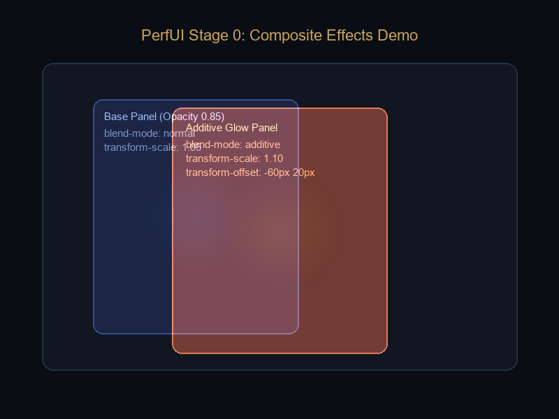

# Composite Effects Demo (Stage 0)

Этот пример демонстрирует совместную работу новых декларативных атрибутов разметки PerfUI:
- `opacity="0..1"` — прозрачность элементов с иерархическим перемножением (`effectiveOpacity`).
- `transform-scale="sx [sy]"` и `transform-pivot="px py"` — визуальное масштабирование без влияния на flex-раскладку.
- `transform-offset="x y"` — визуальное смещение в пикселях и процентах от собственного размера.
- `blend-mode="additive"` — аддитивный режим наложения Direct3D 11 (`ONE:ONE`), создающий яркое свечение на стыке панелей.
- `bg-image="..."` — текстурные подложки.
- `id="..."` — именование узлов разметки (алиас `name`).

## Скриншот рендера

## Исходный код разметки

См. файл [scene.xml](scene.xml).
